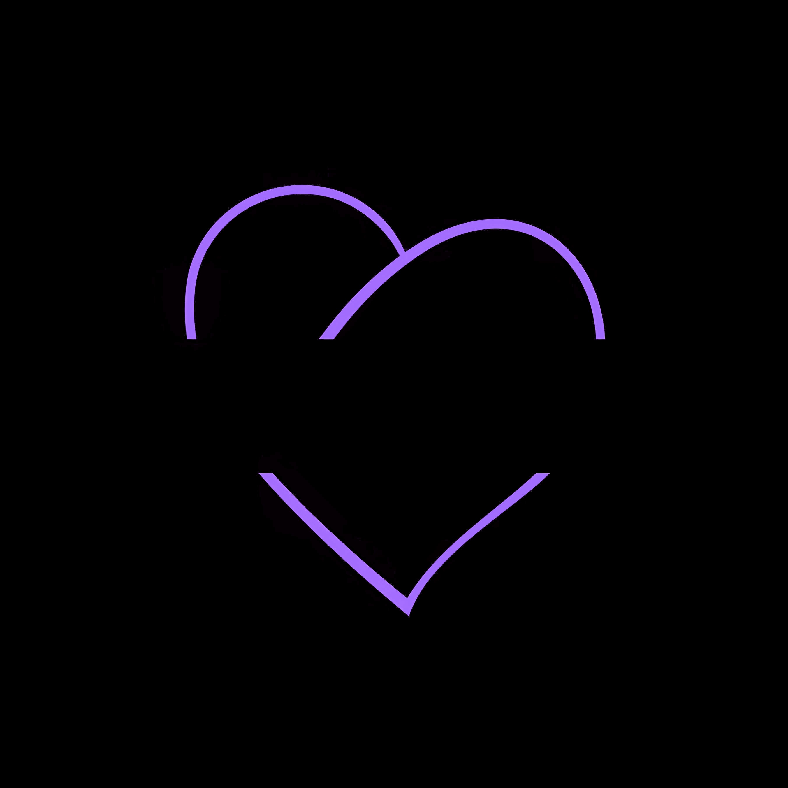
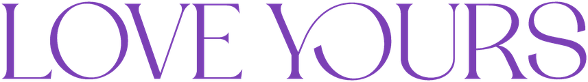
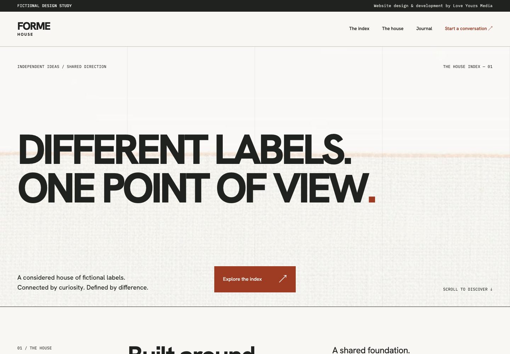

# Design-first websites. Thoughtful engineering.

We are **Love Yours Media**, an independent design and development studio in Manchester, UK. We build distinctive websites and practical digital systems, with care for the journey from first impression to enquiry.

[Visit the studio](https://loveyoursmedia.com/) · [Discuss a project](https://loveyoursmedia.com/contact/)

## Selected work

**FORME HOUSE** · A fictional fashion house, five distinct labels and a complete editorial website.

| Explore | What it demonstrates |
| --- | --- |
| [FORME HOUSE flagship](https://github.com/LYM-loveyours/brand-house-showcase) | An editorial fashion-house concept: distinctive art direction, responsive React pages and considered motion. |
| [Website design studies](https://github.com/LYM-loveyours/service-website-showcases) | Two distinct identities, 22 connected pages, responsive layouts and browser-only interactions. |
| [WordPress service website](https://github.com/LYM-loveyours/service-business-wordpress) | An original six-page website with native Elementor content, a custom child theme and a non-sending enquiry demonstration. |
| [Enquiry workflow](https://github.com/LYM-loveyours/enquiry-workflow-python) | Durable duplicate prevention, bounded retries and explicit handling of uncertain outcomes, using synthetic data. |

Our website examples are fictional businesses. The flagship adapts earlier studio design work with new fictional content and studio-owned neutral imagery and new demonstration artwork. They demonstrate design and implementation, not client results. Private client work and operational systems remain private.

## How we work

Understand the business. Design the journey. Build with care. Test the important paths. Hand over clearly.

Our public examples include setup instructions, source, screenshots, test scope and known limitations. We distinguish a demonstration from an operated production service.

Cofounders: **Dale Boyles** and **Romaan Sheikh**.
